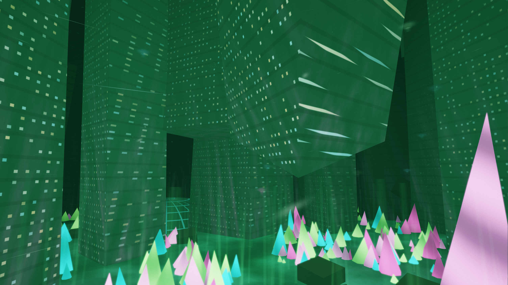

# Sunken City — Drowned Metropolis (2026-11-16)

Metrópolis post-humana muerta, inundada y hundida en aguas profundas, reconquistada por coral
neón iridiscente. Vuelo de cámara libre por cañones de rascacielos inclinados.

## Contenido
- `index.html` — la escena (WebGPU, procedural, autocontenida). Abrir en Chrome/Edge.
- `scene-spec.md` — el spec que la generó.
- `renders/pose0..5.png` — las 6 poses fijas a 2560×1440.
- `video_horizontal.webm` (1920×1080) · `video_vertical.webm` (1080×1920) — clips de 5 s del fly-through.

## Controles
Click = pointer-lock · **WASD** mover · **mouse** mirar · **Q/E** bajar/subir · **Shift** acelerar.
Vistas fijas: `?pose=0..5` · recorrido: `?flythrough=1`.

## Elementos
Cañones de rascacielos inclinados con fachadas de ventanas · campo de coral neón (magenta/cian/
verde) · bosques de kelp · obelisco-monumento coralizado · estadio-domo bioluminiscente colapsado ·
avión estrellado y autos coralizados · cardumen (flocking) · manta hero planeando · medusas ·
partículas (marine snow, burbujas, esporas) · god rays desde la superficie · niebla verde-tóxica.

## Verificación
- **Gate 0 (correctitud):** PASS — orientación OK, ninguna pose vacía.
- **Gate 1 (critic visual aislado):** convergió de *blocker + 6 majors* → pulido en 6 rondas.
- **Gate 2 (performance):** PASS — **avg 4.9 ms · p99 7.7 ms · max 8.5 ms** @ 2560×1440
  (presupuesto ≤ 11 ms avg, ningún frame > 16.7 ms).
- **Bundle:** ~45 KB crudo / ~37 KB minificado (~12 KB gzip).

## Defectos corregidos durante la iteración
Bugs de compilación (writeBuffer no-múltiplo-de-4, `i.prm` en fragment) · peces/kelp que se
lavaban a blanco · obelisco como pared plana · ventanas como stickers → fachadas con rejilla y
líneas de forjado · domo "gizmo" → hundido y atenuado · manta desgarrada → raya limpia ·
coral/avión flotando → rooteados al lecho · techo-caja del mundo → niebla far + cielo sin tapa ·
banding → dithering · **bug de pointer-lock** (overlay sin `pointer-events:none`).
