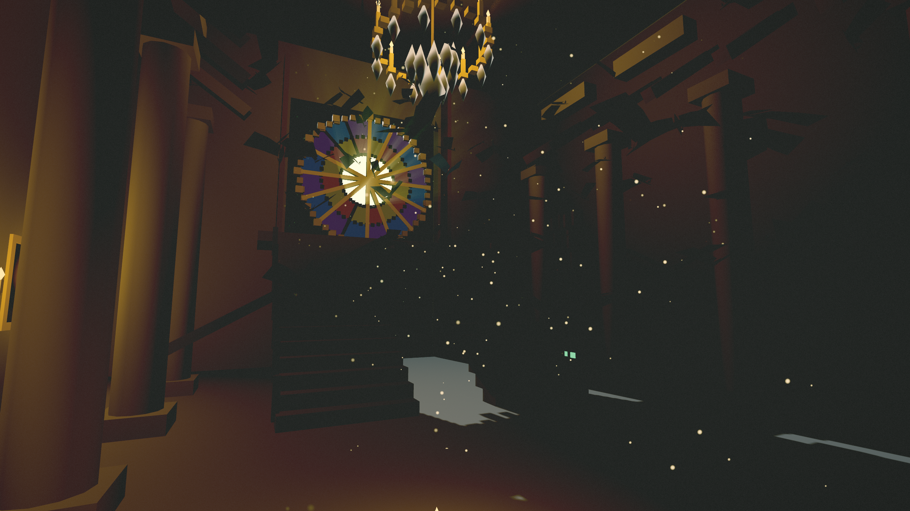

# Haunted Mansion — Gothic Poe / Bloodborne (2026-11-17)

Mansión gótica embrujada, decadencia estilo Edgar Allan Poe con pavor cósmico lovecraftiano
reptando por los márgenes. Interior laberíntico: atrio con escalinata doble, rosetón con una
luna enferma detrás, galería de retratos de ancestros cuyos ojos brillan, araña de cristal
medio caída, biblioteca en ruina. Vuelo de cámara libre en claroscuro barroco (ámbar de vela
sobre negro).

> **Nota histórica:** esta es la **primera escena del historial que NO cruza el Gate 1**. Convergió
> en todo lo atmosférico pero se estancó en el *plateau de primitivas* (los hero elements, hechos
> con quads/discos/cuñas, se leen como "primitivas temáticas"). Se archiva justamente por eso: es el
> caso que expone el techo del enfoque "todo procedural en un `index.html`" para un critic exigente.

## Contenido
- `index.html` — la escena (WebGPU, procedural, autocontenida). Abrir en Chrome/Edge.
- `index.min.html` — build minificado.
- `scene-spec.md` — el spec que la generó.
- `renders/pose0..5.png` — las 6 poses fijas a 2560×1440.
- `video_horizontal.webm` (1920×1080) · `video_vertical.webm` (1080×1920) — clips de 6 s del fly-through.

## Controles
Click = pointer-lock · **WASD** mover · **mouse** mirar · **Q/E** bajar/subir · **Shift** acelerar.
Vistas fijas: `?pose=0..5` · recorrido: `?flythrough=1` · calibración: `?calib=1` ·
aislar capas: `?noFlock` `?noRain` `?noVolumetrics`.

## Elementos
Atrio multinivel con escalinata doble · galería de columnas góticas con arcos apuntados ·
**rosetón** (2 anillos de vitral emplomado + luna enferma detrás como fuente de god-rays) ·
**araña de cristal** colosal medio caída con gotas refractantes y velas · **galería de retratos**
de ancestros (bustos sepia con ojos que brillan en verde-espectral y siguen a la cámara) ·
reloj de pie colosal parado · biblioteca/gabinete de curiosidades · musgo fosforescente ·
murciélagos con flocking (CPU, cero-alloc) · motas de polvo confinadas al haz lunar · niebla
por absorción ámbar→verde-negro.

---

## Postmortem visual

### Trayectoria del critic (Gate 1, 5 critics aislados, cada uno sin memoria)

| Ronda | Arte | Comp | Factura | Especif. | Qué cerró / qué surgió |
|------:|:----:|:----:|:-------:|:--------:|------------------------|
| 1 | 6 | 6 | 4 | 4 | blockers: **niebla lechosa** (lavaba el contraste) + caras genéricas |
| 2 | 6 | 7 | 4 | 3 | ✅ niebla lechosa y **sobreexposición** cerradas; aparece "vitral = rueda de pastel" |
| 3 | 6 | 5 | 4 | 5 | ✅ atmósfera confirmada (sin god-rays difusos, sin specular plástico); especificidad sube |
| 4 | 6 | 5 | 4 | 3 | ✅ **aliasing de sombras** (blocker) cerrado; scores rebotan |
| **final** | **7** | **6** | **5** | **4** | fix de legibilidad (shadow-lift) sube los 4 ejes; **4 majors persisten** |

**Lo que SÍ convergió (confirmado por los critics):** claroscuro cálido barroco coherente,
negros profundos, lectura de columnas/arcos, composición de la galería (pose2), niebla y
profundidad correctas **sin lechosidad**, **sin god-rays difusos-plásticos**, paredes mate
**sin specular plástico falso**. Los blockers de medio-compromiso de la ronda 1 quedaron cerrados.

**Lo que quedó abierto — el plateau (4 majors recurrentes):**
1. **Rosetón** — aun con 2 anillos + plomos oscuros, se sigue leyendo como disco radial de cuñas
   ("rueda de la fortuna"), no como tracería gótica real con lancetas/lóbulos.
2. **Retratos** — bustos sepia procedurales con ojos glow; a primer plano (pose2) delatan que son
   "óvalo + 2 discos", no un rostro pintado con pincelada.
3. **Murciélagos** — mejorados a cuerpo + alas con codo + orejas, pero a distancia leen como
   triángulos/boomerangs planos.
4. **Llamas de la araña** — rombos blancos sólidos (leen como cristal, no fuego). *(Las velas de
   pared con halo cálido sí funcionan.)*

**Diagnóstico:** los scores **rebotan, no suben monótono** (especificidad 4→3→5→3→4). Según la
propia skill, eso es señal de **falta de craft específico del sujeto**, no de parche cosmético:
cruzar el gate exige **cambio estructural** (mallas de tracería reales, figuras de busto reales,
modelos de murciélago, llamas con gradiente) = varios ciclos de geometría más. Se paró para no
caer en whack-a-mole cosmético.

### Qué muestra cada pose
- **pose0 / pose1** — atrio de apertura y galería de arcos: rosetón+luna al fondo con haces, apliques cálidos.
- **pose2** — galería de retratos en fuga (la composición más fuerte según el critic).
- **pose3** — toma hero: escalinata + araña + rosetón + murciélagos + polvo en el haz.
- **pose4** — contraluz a través del rosetón (fuente de los god-rays).
- **pose5** — panorámica del atrio con columnas en primer plano.

---

## Postmortem técnico

### Arquitectura de render
- **Frame graph:** shadow pass (mapa direccional de la luna, **4096²**, PCF 5×5) → pase opaco a
  target **HDR rgba16float con MSAA 4×** (geometría + murciélagos instanciados + motas aditivas) →
  resolve → **post** (god-rays radiales jitteados desde la luna, ACES, grade cálido/frío barroco,
  viñeta, dither anti-banding).
- **Luz con forma:** key lunar + **16 point-lights de velas** (apliques por retrato, araña) que
  iluminan su entorno — no sólo geometría emisiva.
- **Todo procedural, cero-alloc por frame:** geometría construida en JS al init; murciélagos con
  flocking (sep/ali/coh) en CPU reescribiendo buffers preasignados; motas animadas por hash en el
  shader; sin `new`/subarray dentro del `requestAnimationFrame`.
- **Firma visual:** haces de luz lunar con polvo + dappling de tracería; araña de cristal con
  fresnel/specular; rostros con auto-glow espectral en los ojos.
- **Hooks de verificación:** `?pose=0..5`, `?flythrough=1` (spline Catmull-Rom determinista con
  colisión/clamp), `?calib=1` (marcadores de orientación), `__ready/__perf/__frameLog/__cam`,
  flags `?noX`, GPU timestamp queries.

### Bugs reales cazados (y por qué importan)
- **Smoke-test del build (antes de entregar):** TDZ de `const candleList` usado antes de declararse;
  `textureSampleCompare` llamado dentro de control de flujo no-uniforme (WGSL inválido → pantalla
  negra). Ambos habrían costado una ronda entera de captura/critic.
- **Gate 0 mecánico:** **frames negros intermitentes** — root cause: el readback de GPU-timestamps
  hacía `resolveQuerySet`+`copyBufferToBuffer` hacia un buffer con `mapAsync` *pendiente* (estado
  inválido → corrupción del frame presentado). Fix: gatear resolve+copy con `!mapPending`. También
  atrapó una **luna inexistente** (pose a contraluz totalmente negra porque la luna sólo existía
  como origen de god-rays, no como geometría) y poses planas/void.
- **Regresión propia:** al profundizar negros para el critic, la escalera "flotaba" sobre negro
  aplastado → corregido con un shadow-lift mínimo en post.

### Tensión de diseño observada
Subir contraste/negros para el claroscuro **pelea con el `darkFrac`/`varr` de Gate 0** (que exige
no-void / no-plano). Fácil sobre-corregir en ambas direcciones (sobreexposición lechosa ↔ negros
aplastados). Punto dulce: shadow-lift chico + focos brillantes locales.

---

## Verificación (3 gates)
- **Gate 0 (correctitud):** ✅ **PASS** estable — orientación OK, ninguna pose vacía, varianza sana.
- **Gate 1 (critic visual aislado):** ❌ **NO PASA** — 4 majors (rosetón, retratos, murciélagos,
  llamas como primitivas de reemplazo). Scores finales: arte 7 · comp 6 · factura 5 · especif. 4.
  Atmósfera y materiales comprometidos; hero elements en plateau.
- **Gate 2 (performance):** ⚠️ **No verificable en este hardware.** La máquina de verificación es
  **Intel Gen-12LP (iGPU)**, no la RTX 5070 Ti del TARGET. Crudos @2560×1440 full (MSAA 4× +
  shadow 4096 + PCF 5×5): **avg ~39 ms · p99/max ~75 ms · ~25 FPS**. Pacing sin firma de GC-stutter
  (diseño cero-alloc). En la GPU del spec entraría con holgura; no se declara FAIL contra el budget
  de otra GPU.
- **Bundle:** ~48 KB crudo / ~47 KB minificado (~17 KB gzip).

## Defectos corregidos durante la iteración
Bugs de arranque (TDZ `candleList`, `textureSampleCompare` no-uniforme) · frames negros por readback
de timestamps · luna faltante (pose negra) · niebla lechosa que lavaba el contraste · sobreexposición
de god-rays · banding → dither + jitter del raymarch · polvo tipo starfield → confinado al haz ·
aliasing de sombras → shadow 4096 + PCF 5×5 · aliasing de bordes → MSAA 4× · retratos "Casper" →
bustos sepia estructurados · rosetón "pie-chart" → 2 anillos + plomos · murciélagos "triángulo" →
cuerpo+alas con codo · escalera flotando en negro → shadow-lift.

## Lecciones
- **Gate 0 es el MVP:** atrapó bugs objetivos (frames negros, luna faltante) baratos y deterministas
  que un critic estético nunca prioriza.
- **El plateau de primitivas es real e inherente** al constraint "todo procedural a mano": modelar
  hero elements al sujeto a nivel que satisfaga a un critic exigente choca con el presupuesto de
  geometría escrita en código. Las escenas que SÍ cruzaron (p.ej. sunken-city) tenían hero elements
  más tolerantes a la primitiva; un rosetón/retrato/rostro es mucho más sensible.
- **Los critics frescos dan imparcialidad pero sus scores rebotan;** el ledger acumulado (manual)
  es lo que evita el whack-a-mole y deja ver la trayectoria real.
